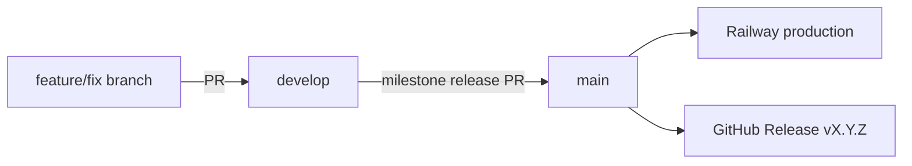

# Release and deployment process

This document describes how we integrate, release, and deploy **Telemetry Tracker** (API + dashboard). SDK packages (`@telemetry-tracker/*`) use separate semver in `packages/*/package.json` and `pnpm publish:packages` — see [README](../README.md#publishing-sdk-packages-to-npm).

User-facing changes are recorded in [CHANGELOG.md](../CHANGELOG.md).

---

## Branch model

| Branch | Role |
|--------|------|
| **`develop`** | Integration branch — **GitHub default**; feature PRs merge here; CI must pass |
| **`main`** | Production — official hosted cloud and semver GitHub Releases |
| **`feature/*`, `fix/*`** | Short-lived; open PRs against **`develop`** |



**Deploy ≠ release.** Railway production deploys from **`main`**. Self-hosters and GitHub Release consumers follow **semver tags** on `main`.

There is no separate staging deploy yet — validate on `develop` locally before milestone promotion.

### `develop` merge gate

Feature and fix PRs merge into **`develop`**. Branch protection (Settings → Branches → `develop`):

| Rule | Mechanism |
|------|-----------|
| PR required | Branch protection — no direct pushes to `develop` |
| CI must pass | Required status check: `build` ([`.github/workflows/ci.yml`](../.github/workflows/ci.yml)) |
| Bugbot | Required status check: `bugbot-review` — **temporarily no-op** (`BUGBOT_REVIEW_ENABLED=false`); see [CONTRIBUTING.md](../CONTRIBUTING.md#ai-code-review-bugbot) |
| Branch up to date | Require branches to be up to date before merging |
| Human approvals | **0** — GitHub cannot require “approval only when author ≠ maintainer”; use `maintainer-review` check instead |
| Maintainer gate | Required status check: `maintainer-review` — passes automatically when PR author is @unjica; otherwise requires your APPROVED review |

**GitHub settings (required):** On the `develop` rule, set **Required approvals to 0** and add **`maintainer-review`** and **`bugbot-review`** to required status checks (with `build`). Do **not** require `Cursor Bugbot` directly — fork PRs often never receive that app check. Keep `bugbot-review` required while paused so the check still runs as success.

**Your own PRs to `develop`:** `maintainer-review` passes automatically; `bugbot-review` currently passes without waiting for Cursor Bugbot (re-enable via `BUGBOT_REVIEW_ENABLED=true`).

**Adding status checks:** GitHub lists checks only after they have run at least once on a PR. Open or update a PR, wait for `build`, `bugbot-review`, and `maintainer-review` to finish, then edit the `develop` rule if a check is missing.

Bugbot findings default to a **`neutral`** check conclusion — they comment but do not block merge unless **fail on unresolved issues** is enabled in the Cursor Bugbot dashboard. Pause the GitHub App in the [Cursor dashboard](https://www.cursor.com/dashboard/bugbot) if you want to stop PR comments while the gate is disabled.

### `main` merge gate

GitHub cannot require “your approval only when you are not the PR author” (authors cannot approve their own PRs). **`main`** uses:

| Rule | Mechanism |
|------|-----------|
| PR required | Branch protection |
| CI must pass | Required check: `build` |
| Bugbot (recommended) | Required check: `bugbot-review` on `develop`; on `main` optional — see [CONTRIBUTING.md](../CONTRIBUTING.md#ai-code-review-bugbot) |
| **Maintainer approval when author ≠ @unjica** | Required check: `maintainer-review` ([workflow](../.github/workflows/maintainer-review.yml)) |
| **Your own PRs to `main`** | `maintainer-review` passes automatically; merge after `build` is green |
| Review requests | [CODEOWNERS](../.github/CODEOWNERS) notifies @unjica on PRs to `main` |

After the maintainer-review workflow is on **`main`**, add `maintainer-review` to required status checks (Settings → Branches → `main`, or maintainer API update).

---

## Release cadence

Releases are **milestone-driven**:

1. Track work in a GitHub milestone (e.g. “v1.2 — …”).
2. Merge completed work into **`develop`**; keep [CHANGELOG.md](../CHANGELOG.md) `[Unreleased]` up to date.
3. When the milestone is complete and CI is green, promote **`develop` → `main`** (release PR or fast-forward).
4. Tag **`main`**, publish GitHub Release, migrate production DB, verify deploy.
5. **Sync `develop` with `main`** — always merge `main` back into `develop` after promotion (see [checklist](#on-main-after-promotion)). Squash merges, merge commits, and post-promotion commits on `main` (e.g. CHANGELOG finalization) leave `develop` behind otherwise.

**Hotfixes** on production: branch from **`main`**, fix, merge to **`main`**, tag a **patch** version, then merge **`main` → `develop`** so branches stay aligned. Assign PRs and release PRs to a milestone per [Milestones vs hotfixes](#milestones-vs-hotfixes-audit-trail).

### Process notes (merge hygiene & milestones)

- **Do not merge release PRs** (`develop` → `main`, or hotfix → `main`) until **all required checks are green** (`build`, and on `develop` also `bugbot-review` / `maintainer-review` as configured).
- **Stacked / multi-PR features:** the final integration PR that lands the feature on `develop` must run the **full API + dashboard** test suites (not a subset). Prefer one green CI pass on that integration PR before release promotion.
- **Assign feature PRs to a milestone** whenever possible (active product line or patch-line milestone) so shipped work stays auditable.
- **Prefer one production smoke-test pass** (health, migrations, critical paths for the milestone — see [Post-deploy verification](#post-deploy-verification) and `scripts/smoke-production.sh` / notification channel checks) **before closing a milestone**.
- **Taxonomy:** **milestones** = release lines (e.g. `v1.14.x — Notifications`); **parent issues** = long-lived vision/roadmap; **child issues** = implementation that ships inside a milestone. Closing a milestone does **not** require closing the parent vision issue — parents **should stay open** as living roadmap even after children merge.
  - Example: Notifications parent [#492](https://github.com/Telemetry-Tracker/telemetry-tracker/issues/492) and Alert Rules parent [#493](https://github.com/Telemetry-Tracker/telemetry-tracker/issues/493); children (#225, #508, #532–#535, …) ship under their milestones while the parent remains the scope source of truth.

---

## Milestones vs hotfixes (audit trail)

**Milestone-driven releases** (typical **MINOR** / **MAJOR** promotion) follow the cadence above: scope work in a GitHub milestone, merge into `develop`, then promote `develop` → `main`.

**PATCH releases** (production hotfixes, docs-only promotions, and other small semver bumps on `main`) use the same promote → tag → GitHub Release → sync `develop` flow, but they are not required to open a new product milestone for every patch.

For **audit trail**, PATCH and docs hotfixes **should** still:

1. Assign the integrating PR(s) on `develop` to a milestone — typically the **active patch-line milestone** (e.g. `v1.4.x — Platform releases`).
2. Assign the **`develop` → `main` release PR** to that same milestone.
3. Update the milestone **description** with the shipped semver (e.g. **v1.4.3**, **v1.4.4**) when the release completes.

If the patch-line milestone is **closed**, you may still assign merged PRs to it retroactively, or open a new patch-line milestone if you prefer a clean bucket for the next patches.

Product update emails remain policy-driven ([MARKETING-EMAIL.md](./MARKETING-EMAIL.md)); they send on **line close** of a completed minor (whole `vX.Y.*`), not when opening the next milestone’s first `.0`. Docs-only PATCH releases usually **skip** subscriber email.

---

## Versioning

| Artifact | Version | Tag / registry |
|----------|---------|----------------|
| **App** (API + dashboard) | Semver on `main` | `v1.0.0`, `v1.1.0`, … |
| **SDKs** | Per-package in `packages/*/package.json` | npm (`pnpm publish:packages`) |

### Semver guidance

App releases use **`vX.Y.Z`**:

| Component | Bump name | When |
|-----------|-----------|------|
| **X** | **MAJOR** | Breaking ingest/HTTP contract, auth model, required env vars, destructive migrations |
| **Y** | **MINOR** | Features, backward-compatible migrations, dashboard UX (typical milestone release) |
| **Z** | **PATCH** | Bug fixes and hotfixes on `main` |

Product update emails (see [MARKETING-EMAIL.md](./MARKETING-EMAIL.md#when-to-send-maintainer-policy)) send when **closing** a completed minor line (last intended `vX.Y.z` before the next milestone), summarizing all `vX.Y.*` since the previous product email — **not** when tagging the first `.0` of a new line. Mid-line **Z**-only hotfixes stay skip.

Always document **migrations**, **new env vars**, and **breaking changes** in CHANGELOG and the GitHub Release notes.

---

## Release checklist (maintainers)

### Before promoting `develop` → `main`

- [ ] GitHub milestone complete (or release scope agreed)
- [ ] [CHANGELOG.md](../CHANGELOG.md) `[Unreleased]` section complete
- [ ] CI green on `develop` (`pnpm lint`, `pnpm test`, `pnpm -r run build`)
- [ ] Self-host upgrade notes ready (migrations, env vars)
- [ ] If this closes a milestone / is the **last intended release** of `vX.Y.*`: confirm `CHANGELOG.md` covers the whole line and plan to run [production migrations](#3-database-migrations-production) **before** pushing the tag — then **close the `vX.Y.x — …` GitHub milestone** after the final tag so the [product update email](./MARKETING-EMAIL.md#line-close-send-preferred) auto-sends (tag push alone does **not** email)
- [ ] If this **opens** a new minor (`vX.Y.0`) while the previous line was already emailed (or will be emailed on its final tag): no product email for the new line yet

### On `main` after promotion

1. **Finalize CHANGELOG** — rename `[Unreleased]` to `[X.Y.Z] - YYYY-MM-DD`. Prefer doing this in the **`develop` → `main`** release PR so `develop` and `main` stay aligned; if you commit on `main` after promotion, you **must** sync `develop` in step 9.
2. **Deploy** — Railway rebuilds `main` automatically when the release PR merges; see [Deploy runbook](#deploy-runbook-railway).
3. **Production DB** — run [migrations](#3-database-migrations-production) **before tagging** on MINOR (Y) / MAJOR (X) releases (and before a line-close product email). The release email workflow reads production Postgres but does not migrate (use the public `DATABASE_URL` in GitHub secrets — see [MARKETING-EMAIL.md](./MARKETING-EMAIL.md#line-close-send-preferred)).
4. **Post-deploy** — [verification](#post-deploy-verification).
5. **Tag** — after deploy and migrations are green. Pushing a `vX.Y.0` tag auto-sends the product email for the **previous** minor line; mid-line patch tags do not send ([MARKETING-EMAIL.md](./MARKETING-EMAIL.md#automatic-send-on-tag-push-default)). Closing the `vX.Y.x` milestone after the final tag also works ([MARKETING-EMAIL.md](./MARKETING-EMAIL.md#line-close-send-preferred)). **Push the tag only after the release PR is merged to `main`** so `CHANGELOG.md` contains the version section when any email workflow runs (an early tag push can fail once, then succeed on retag):
   ```bash
   git checkout main && git pull origin main
   git tag -a v1.1.0 -m "Telemetry Tracker v1.1.0"
   git push origin v1.1.0
   ```
6. **GitHub Release** — tag push automatically runs [GitHub Release](../.github/workflows/github-release.yml), publishing the matching version section from `CHANGELOG.md` with title `Telemetry Tracker vX.Y.Z`. Verify the **GitHub Release** workflow run succeeded and the release exists with author `github-actions[bot]`:
   ```bash
   VERSION=1.2.0
   gh run list --workflow github-release.yml
   gh release view "v${VERSION}"
   gh api "repos/Telemetry-Tracker/telemetry-tracker/releases/tags/v${VERSION}" --jq '.author.login'
   ```
   The workflow checks out the tag, fails for a missing tag or missing/empty changelog section, and leaves existing releases untouched. Only the highest stable semver tag is marked latest; older backfills use `--latest=false`. It never creates drafts or prereleases.

   **Fallback:** after fixing a failed run, retry it or dispatch against a branch containing the workflow:
   ```bash
   gh workflow run github-release.yml --ref main -f tag="v${VERSION}"
   # Optional preview (creates nothing):
   gh workflow run github-release.yml --ref main -f tag="v${VERSION}" -f dry_run=true
   ```
   If automation is unavailable, use the manual fallback in [RELEASE_NOTES_TEMPLATE.md](./RELEASE_NOTES_TEMPLATE.md). Verify no release already exists first; manual creation uses your own account rather than the bot.
7. **SDK** — if ingest/SDK contract changed, bump `packages/*/package.json` and `pnpm publish:packages`.
8. **Product update email** — when this tag is the **last intended release** of a minor line, **close the `vX.Y.x — …` GitHub milestone** after the tag exists. That triggers [Release product email](../.github/workflows/release-email.yml) with derived `version` / `previous_version` and **`line_close=true`** (whole **`vX.Y.*`** line; ledger key **`X.Y`**). Opening a new `vX.Y.0` and mid-line patches do **not** send. If the line was already emailed, the ledger skips duplicates. Manual dispatch (`dry_run` / retry) remains available ([MARKETING-EMAIL.md](./MARKETING-EMAIL.md#line-close-send-preferred)). After the send completes, note date and recipient count in the GitHub Release. For exceptional single-version PATCH backfill, use `--force` — see [MARKETING-EMAIL.md](./MARKETING-EMAIL.md#manual-send-cli--backfill).
9. **Sync `develop`** — merge **`main` into `develop`** and push after every release (milestone promotion or hotfix). Required whenever `main` has commits not on `develop` — including squash merges, merge commits from the release PR, and any post-promotion edits on `main`:
   ```bash
   git checkout develop && git pull origin develop
   git merge origin/main
   git push origin develop
   ```

---

## Deploy runbook (Railway)

Production uses **three Railway services** (+ optional workers/cron):

| Service | Root directory | Builder |
|---------|----------------|---------|
| PostgreSQL | — | Railway Postgres |
| API | `apps/api` | Railpack (not Dockerfile) |
| Dashboard | repo root (empty) | Dockerfile |
| Retention cron (optional) | `apps/api` | Cron → `node dist/jobs/run-retention.js` |
| Alert rules evaluator cron (optional) | `apps/api` | Cron → `node dist/jobs/run-alert-rules-evaluator.js` |
| Alert webhook worker (optional) | `apps/api` | Always-on → `node dist/jobs/run-alert-webhook-worker.js` |

### 1. Trigger deploy

- **Automatic:** push/merge to **`main`**. Each service rebuilds when its watch paths change.
- **Manual:** Railway dashboard → service → **Redeploy**.

### 2. CI gate (GitHub)

On push and pull requests to **`develop`** and **`main`**, CI runs ([`.github/workflows/ci.yml`](../.github/workflows/ci.yml)):

- `pnpm lint`
- `prisma migrate deploy` (against CI Postgres only)
- `pnpm test` with `RUN_DB_INTEGRATION_TESTS=true`
- `pnpm -r run build`
- telemetry-core dist drift check

**Do not promote to `main`, tag, or deploy production if CI is failing.**

### 3. Database migrations (production)

CI does **not** migrate your production database during normal builds. Apply migrations after API deploy and **before pushing a MINOR (Y) / MAJOR (X) tag** (see [On `main` after promotion](#on-main-after-promotion)). The [Release product email](../.github/workflows/release-email.yml) workflow connects to production Postgres for the send ledger only — use Railway’s **public** database URL in GitHub secrets, not `postgres.railway.internal`.

```bash
DATABASE_URL="postgresql://..." pnpm --filter api exec prisma migrate deploy
```

Use Railway Postgres **public** URL from your laptop, or a Railway one-off shell with `DATABASE_URL` set.

Alternatively, add to the API **start command** (only if you accept migrate-on-every-start):

```bash
pnpm exec prisma migrate deploy && node dist/index.js
```

Prefer one-off or deploy hook if you want explicit control.

### 4. Environment variables

Set on **each Railway service** (not only a local `.env`). Core vars: [DEPLOYMENT.md](../DEPLOYMENT.md). Email & Stripe: [BILLING.md](./BILLING.md). Railway setup: [RAILWAY.md](./RAILWAY.md).

**API (required in production):**

- `DATABASE_URL`, `NODE_ENV=production`, `HOST=0.0.0.0`
- `HEALTH_CHECK_DATABASE=true`
- `CORS_ORIGINS` or `DASHBOARD_ORIGIN` = dashboard URL
- `TELEMETRY_DASHBOARD_ORIGIN` = dashboard URL (no trailing slash)

**API (recommended):**

- `RESEND_API_KEY`, `TELEMETRY_EMAIL_FROM` — invites, password reset, notification email
- `TELEMETRY_ALLOW_REGISTRATION=false` — after first user exists

**API (never in production):**

- `INGEST_ALLOW_UNAUTHENTICATED`
- `TELEMETRY_ALLOW_UNAUTHENTICATED_READS`

**Dashboard:**

- `API_URL` = public API URL (no trailing slash)
- `NEXT_PUBLIC_SITE_URL` = public dashboard URL

### 5. Retention cron

Schedule nightly (e.g. `0 3 * * *` UTC):

```bash
node dist/jobs/run-retention.js
```

Same `DATABASE_URL` as the API. See [RAILWAY.md](./RAILWAY.md#retention-cron).

### 6. Alert rules evaluator cron

If CUSTOM Alert Rules use schedule-oriented conditions (`HEARTBEAT`, `NO_EVENTS`, `SESSION_DROP`, `QUOTA_PERCENT`, scheduled `ERROR_RATE`), add a Railway cron (manual wiring — not auto-provisioned):

```bash
node dist/jobs/run-alert-rules-evaluator.js
```

Default schedule `*/5 * * * *` (match `ALERT_RULES_SCHEDULE_INTERVAL_MINUTES`). Same `DATABASE_URL` as the API. Do **not** repurpose or alter any `brief-worker` service. See [RAILWAY.md](./RAILWAY.md#alert-rules-evaluator-cron) and [ALERT-RULES.md](./ALERT-RULES.md).

### 7. Alert webhook worker

If alert webhooks are enabled, keep a continuous worker running (not cron):

```bash
node dist/jobs/run-alert-webhook-worker.js
```

Same `DATABASE_URL` as the API. Confirm logs show `"status":"idle"` (or processing)
JSON. See [RAILWAY.md](./RAILWAY.md#alert-webhook-worker) and
[ALERT-WEBHOOKS.md](./ALERT-WEBHOOKS.md).

---

## Post-deploy verification

```bash
./scripts/verify-prod-config.sh
# Custom hosts: VERIFY_API_URL=... VERIFY_DASHBOARD_URL=... ./scripts/verify-prod-config.sh

# Uptime probe (also runs every 15 min via GitHub Actions on main):
./scripts/check-production-uptime.sh
```

Or individual curls:

```bash
curl -sS https://<api-host>/health
# → {"ok":true,"version":"1.6.2","database":"ok","database_latency_ms":5,"email":"configured"}

curl -sS -o /dev/null -w "%{http_code}" -X POST https://<api-host>/ingest/event \
  -H "Content-Type: application/json" -d '{"app":"t","name":"t"}'
# → 401

curl -sS -o /dev/null -w "%{http_code}" https://<api-host>/api/errors
# → 401
```

In the browser:

- Dashboard loads; `/dashboard` redirects to login when logged out
- Register (if allowed) → org → project → API key → ingest → Overview shows data
- Notifications bell and Appearance theme (v1.1+)

See also [PRODUCTION-READINESS.md](./PRODUCTION-READINESS.md).

---

## Bootstrap (first production install)

1. Deploy Postgres, API, dashboard; run migrations.
2. Open dashboard → **Register** (allowed when no users exist).
3. Create organization, project, API key.
4. Set `TELEMETRY_ALLOW_REGISTRATION=false` on API.
5. Schedule retention cron.

---

## v1.0.0 (2026-06-26)

First production-ready self-hosted release. Full changelog: [CHANGELOG.md#100---2026-06-26](../CHANGELOG.md#100---2026-06-26).

**Includes:**

- Multi-tenant ingest (events, errors, sessions, batch) with API keys and plan limits
- Next.js dashboard (overview, errors, events, sessions, org/team/keys settings)
- Email/password auth, org invites, password reset (Resend)
- RBAC (OWNER / EDITOR / VIEWER)
- Optional Stripe billing (checkout, portal, webhooks)
- SDKs `@telemetry-tracker/*` v1.3.0 in-repo (published as `@telemetry-tracker/core`, `@telemetry-tracker/next`, `@telemetry-tracker/node`, `@telemetry-tracker/react-native`)
- Retention job, deployment docs, CI with DB integration tests

**Known limitations:**

- Per-project ingest RPS is in-memory (single API process)
- Project alert webhooks for spike/quota — see [ALERT-WEBHOOKS.md](./ALERT-WEBHOOKS.md)
- Open sessions without `ended_at` are not pruned by retention until closed

**Live reference deployment:** `telemetry-tracker.com` (dashboard) / `api.telemetry-tracker.com` (API). Legacy: `telemetry-api.tacko.io`, `telemetry-tracker.tacko.io`.
